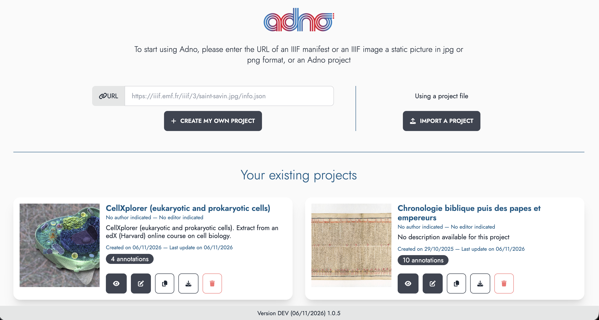
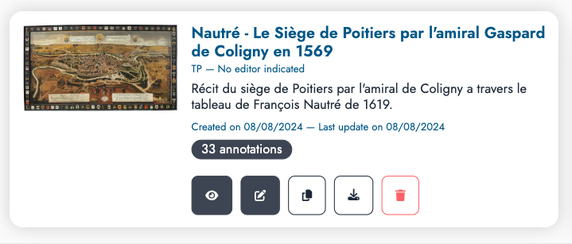
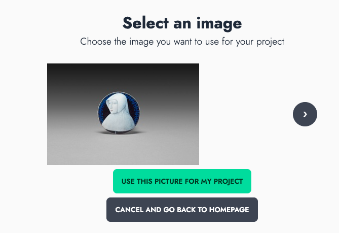
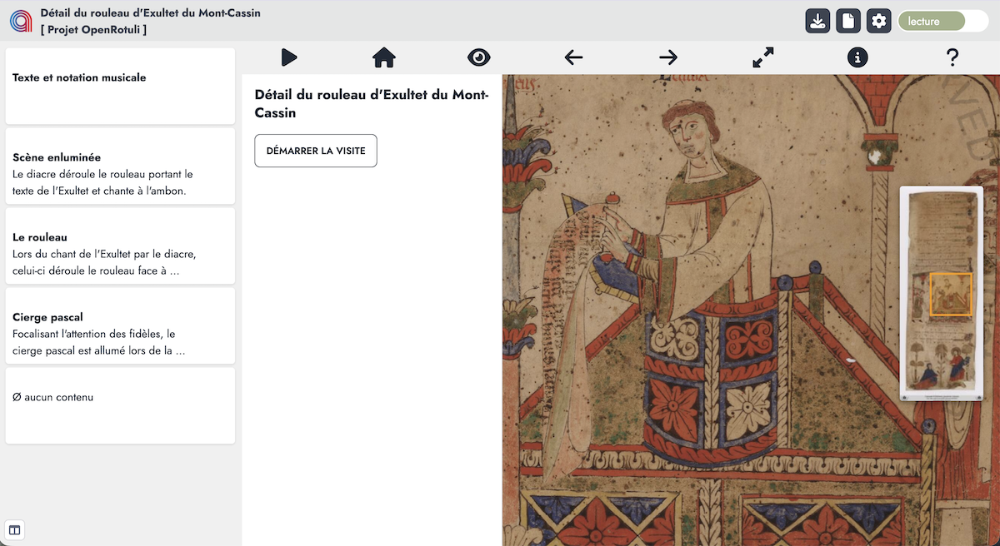
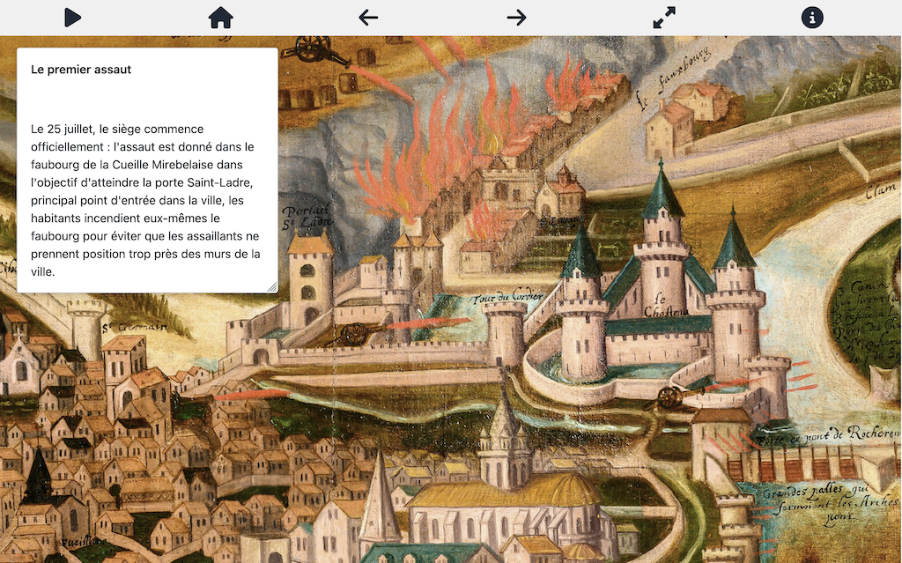
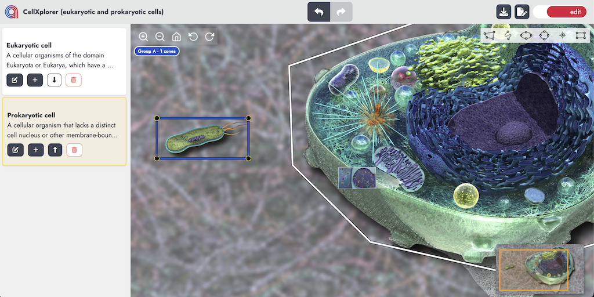
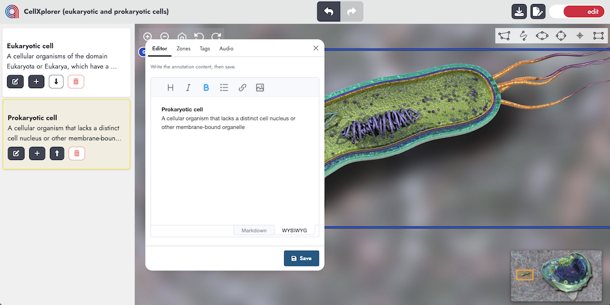
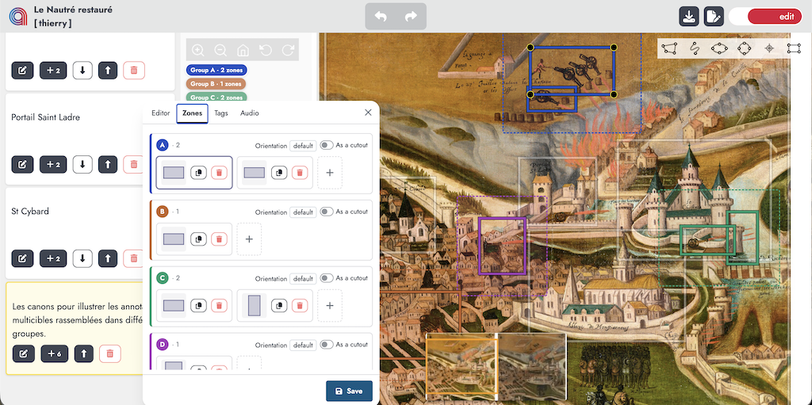
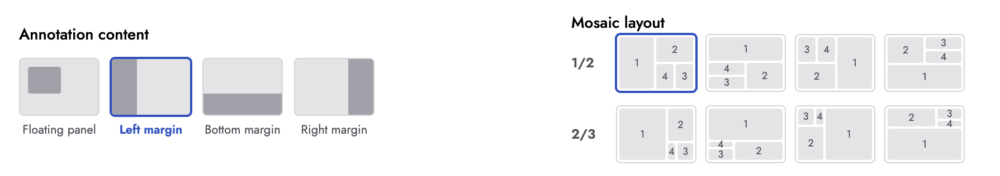

## An online application

The easiest way to get started is to use the [online instance](https://w.adno.app) of Adno. It is free and does not require registration. You can also start from one of the [examples](/en/example/) provided on this site.

<a href="https://w.adno.app" target="_blank"><button type="button" class="btn btn-primary">Get started!</button></a>
<a href="/en/example/" target="_blank"><button type="button" class="btn btn-success">Examples</button></a>

Adno is free software, which means you can use, study, modify, adapt it to your own needs and redistribute it under the terms of the [MIT](https://github.com/adnodev/adno?tab=MIT-1-ov-file) license. You can therefore install it for yourself and for others. The sources and installation instructions are available on [GitHub](https://github.com/adnodev/adno).


Adno is still under development; its features and interface are subject to change.


## Start a project

The home screen is Adno's dashboard: it lets you create, import and manage projects stored in your browser.



This dashboard allows you to:

- **create a project** by entering in the form the web address of a static image, an IIIF image or manifest, or an Adno project,
- **import a project** by loading an Adno project file,
- **manage your projects** previously created and stored in your browser.



For each project stored in the browser, a series of buttons gives access to the following features:

- <i class="fa-solid fa-eye"></i> **View** the project,
- <i class="fa-solid fa-pen-to-square"></i> **Edit** the project,
- <i class="fa-solid fa-copy"></i> **Duplicate** the project,
- <i class="fa-solid fa-download"></i> **Download** the project file in Adno format (Web Annotation Model) or IIIF (manifest),
- <i class="fa-solid fa-trash"></i> **Delete** the project.

### Start with a static image

The image in `png` or `jpg` format must be permanently available online and you must know its address (the URL). Enter this URL in the dedicated field, then click `Create my project`.

```
https://upload.wikimedia.org/wikipedia/commons/f/f3/Chenille_de_Grand_porte_queue_%28macaon%29.jpg
```

### Start with an IIIF resource

If you are not familiar with IIIF or want to learn more, you can check out the [IIIF Online Workshop](https://training.iiif.io/iiif-online-workshop/) provided by the [IIIF Consortium](https://iiif.io) and led by Glen Robson.

You can start with an IIIF manifest or an IIIF image.

#### An IIIF manifest


This is a URL provided by the publisher of the document. This link is often displayed next to the IIIF logo shown here.

The manifest describes the document with its metadata and the references of the images it contains.

```
https://api.artic.edu/api/v1/artworks/251131/manifest.json
```

If there are several images, browse them with the `›` button, then click `Use this image for my project` (or `Cancel and return to home`).



You can also retrieve the `info.json` URL of each image in the manifest by using this [form](/en/blog/how-to-extract-images-from-a-manifest/).

#### An IIIF image

Use the direct URL of an IIIF image, which always ends with `info.json`.

```
https://gallica.bnf.fr/iiif/ark:/12148/btv1b8626777x/f13/info.json
```

### Start with an example

The [examples page](/en/example/) offers resources from a wide range of domains to get you started.

### Import a project

Use the `Import a project` button to upload a previously downloaded Adno file.

## View and edit your project

The same interface lets you switch easily between reading and editing a project by clicking the colored **view** / **edit** switch at the top right of the interface.

### View mode



The navigation bar contains, on the left, the Adno logo to return to the dashboard, followed by the project information, and, on the right, the switch to go from view mode to edit mode, along with three buttons:

- **<i class="fa-solid fa-download"></i>** to save the project,
- **<i class="fa-solid fa-file"></i>** to view the project information,
- **<i class="fa-solid fa-gear"></i>** to set the viewer settings:
  - View
    - show the overview navigator,
    - show outlines,
    - show only the outline of the current annotation,
    - show the annotation list on the side,
    - set the default reading orientation,
    - enable image rotation,
    - set how orientation transitions behave,
    - show the toolbar,
    - show the toolbar in full screen mode,
    - show an icon inside shapes,
    - set the layout used to display multi-target annotations.
  - Navigation
    - filter annotations by keywords,
    - delay between two annotations (5 seconds by default),
    - start autoplay at the first annotation,
    - start autoplay automatically on load,
    - set the audio rendering mode.
  - Annotation
    - annotation thickness,
    - annotation outline colors,
    - outline color of the current annotation,
    - annotation group colors.

The collapsible list of annotations is on the left of the screen. By default, the area showing the content of the current annotation is to the left of the image; it can also be placed at the bottom or on the right, or be floating, depending on the settings.

The icons above the image trigger actions (also available from the keyboard):

- <i class="fa-solid fa-play"></i> / <i class="fa-solid fa-pause"></i> **Autoplay** / **Pause** — keys `P` or `p`,
- <i class="fa-solid fa-house"></i> **Back** to the beginning of the annotations,
- <i class="fa-solid fa-eye"></i> / <i class="fa-solid fa-eye-slash"></i> **Show** / **Hide** annotation outlines — keys `S` or `s`,
- <i class="fa-solid fa-arrow-left"></i> **Previous annotation** — key `←`,
- <i class="fa-solid fa-arrow-right"></i> **Next annotation** — key `→`,
- <i class="fa-solid fa-expand"></i> **Full screen** — key `E`,
- <i class="fa-solid fa-circle-info"></i> **Information** about the project,
- <i class="fa-solid fa-question"></i> **Help** and keyboard shortcuts.

#### Annotation list

Clicking an annotation card selects it as the current annotation and moves the image to the area associated with it, or to the area enclosing all the areas associated with it in the case of a multi-target annotation.

An icon at the bottom left of the screen lets you control how the annotation list is displayed:

- expanded,
- collapsed, in which case annotation numbers are shown,
- expanded on hover (dynamic display), otherwise collapsed.

#### Full screen view

In full screen view, only the current annotation is visible. Whether the icons are displayed can be set in the settings.



#### Keyboard shortcuts

Keyboard shortcuts improve accessibility:

- `p` or `P`: start autoplay,
- `e` or `E`: toggle full screen,
- `s` or `S`: show or hide annotation outlines,
- `t` or `T`: show or hide the buttons,
- <code><i class="fa-solid fa-arrow-left"></i></code> and <code><i class="fa-solid fa-arrow-right"></i></code>: move from the current annotation to the previous or the next one.

### Edit mode



The navigation bar contains, on the left, the Adno logo to return to the dashboard and the project information, in the center the buttons to undo or redo the last actions, and on the right a switch to go from edit mode to view mode, along with a button to save the project and another to edit the project information.

- <i class="fa-solid fa-reply "></i> **undo** the last action,
- <i class="fa-solid fa-share"></i> **redo** the undone action,
- <i class="fa-solid fa-download"></i> **save** the project,
- <i class="fa-solid fa-file-pen"></i> **edit** the project information.

To create a new annotation, choose an annotation shape:


Then select an area on the image by clicking and dragging. As soon as you release, an empty annotation is added to the annotation list. Then click the edit button to add content, and finally `Save`.

To modify the content of an existing annotation, click its card, then the edit button. To resize it, drag the small circles placed on its outline (regular shapes).

Actions to manage each annotation from the annotation list:

- <i class="fa-solid fa-pen-to-square"></i> **Edit** this annotation,
- <i class="fa-solid fa-plus"></i> **Add** a new target to the annotation,
- **<i class="fa-solid fa-up-long"></i> <i class="fa-solid fa-down-long"></i> Move** the annotation within the annotation list,
- **<i class="fa-solid fa-trash"></i> Delete** the annotation.

#### Edit an annotation



This modal window has four tabs:

- **Editor**: edit the content of the annotation,
- **Zones**: manage the target areas on the image,
- **Tags**: associate keywords with the annotation,
- **Audio**: associate an audio resource with the annotation.

##### Editor tab

The content of an annotation is generally a short text. However, it is possible to insert rich content.

Two editing modes are available, which you choose with the switch at the bottom of the window (WYSIWYG by default):

- [WYSIWYG](https://en.wikipedia.org/wiki/What_you_see_is_what_you_get) with icons (heading levels, italics, bold, bulleted list, hyperlink, image),
- [Markdown](https://en.wikipedia.org/wiki/Markdown): a lightweight text markup system, which is how annotation content is stored.

##### Managing zones

One of Adno's distinctive features is the ability to handle multi-target annotations, that is, annotations that point to several areas of the image.

**In edit mode**

The *Zones* tab of the annotation editing window lets you manage the targets of the current annotation. Targets can be split into different groups so that they are displayed separately. The display layout is automatically driven by this split into groups.



There can be up to four groups. On the image, colored badges show the groups used by the annotation and the number of targets in each.

For each group:

- header: the group label (A, B, C or D) and the number of targets it contains, then the orientation of the annotation and the display option used when the orientation differs from the project default;
- body: the list of targets; drag and drop lets you move them from one group to another;
- for each target:
  - a preview of the target's shape,
  - <i class="fa-solid fa-copy"></i> copy the target's URL, as defined by the IIIF Image API,
  - <i class="fa-solid fa-trash"></i> delete the target;
- the `+ ADD A GROUP` button adds a new group, up to a maximum of four.

**In view mode**: the content of each annotation is displayed in a margin of the image (left, right or bottom) or in a floating window. Several cases arise when displaying annotations:

- an annotation with a single target, or several targets gathered in a single group: the focus is on the bounding rectangle of all the targets,
- an annotation with several groups: there are as many display areas as groups; these areas are arranged in a spiral, according to the mosaic layout chosen in the settings (ratio of 1/2 or 2/3, starting vertically or horizontally).


**Settings**: the viewer settings (<i class="fa-solid fa-gear"></i>) let you choose where the annotation content is displayed (floating panel, or margin on the left, bottom or right) and the mosaic layout of the target groups.



##### Managing tags

This tab lets you associate one or more keywords with each annotation. You can select an existing keyword or create a new one. Remember to press the `Enter` key after typing each keyword.

In the viewer settings, you can then follow routes through the annotations by keyword.

##### Associating audio

This tab lets you associate an audio resource with the annotation. The first field takes the URL of the audio file and the second takes information about the resource (credit or other).

In the viewer settings, specify how audio is played: individually or as spatialized sound.

## Retrieve your projects

Projects are stored in your browser. You will find them again by reopening a session on the site where they were created.


**Remember to download your projects regularly**

In private browsing, projects are "forgotten" when you close the session. The same can happen with restrictive browser settings.


## Share your projects

Present in various places in the Adno interface, the **<i class="fas fa-download"></i>** button opens a modal window showing how to save and share a project by exporting it as an Adno file or an IIIF manifest.

In either case, the file is a simple text file in [JSON format](https://json.org). It is generally very light, so you can easily send it by e-mail. Once they have imported it into Adno, your correspondent will be able to view it, and also suggest variations or corrections to your project.

You can also place your file online and distribute its URL. To do this, you can use a website or a file server. The IPFS protocol offers an interesting decentralized alternative.

See the [Google Drive](/en/docs/references/gdrive/), [Dropbox](/en/docs/references/dropbox/) or [IPFS](/en/docs/references/ipfs/) pages of the documentation's reference guide to find out how to use these services to host images, IIIF manifests or Adno projects.

### Embed a project in a web page

Once your Adno project is online, you can make it visible in a web page by inserting an `iframe` tag and adjusting the parameters below.

```
<iframe
    src="https://w.adno.app/#/embed?url=PROJECT_URL"
    title="Project title"
    height="600px"
    width="100%"
    allow="fullscreen"
></iframe>

```


For added safety, it is recommended to encode the URL passed as a parameter. Adno provides a utility to do this while adjusting the parameters. Simply add `/#/link` after the site URL. Example: [https://w.adno.app/#/link](https://w.adno.app/#/link).


By inserting the URL of an image (IIIF or not) or of an IIIF manifest, you get an IIIF viewer that is easy to install.

The [Page Block Adno](https://github.com/adnodev/Omeka-S-module-PageBlockAdno) module allows Adno projects to be viewed in the pages of Omeka S sites.

You can also use the [Adno views tags](https://github.com/adnodev/adno-views-tag) component to embed different types of visualization (lists, slideshows, etc.).

## Issues

Adno runs in the browser and relies on resources hosted elsewhere on the web. This approach may be subject to restrictions that can affect how Adno works and how it integrates into web pages.

The most common cases:

- It is not possible to insert a resource with an address beginning with `http` into a secure site served over `https`. For example, if you upload an image to the [IIIFHosting](http://iiifhosting.com/) service, the default URL provided starts with `http`. To use it in Adno, remember to change `http` to `https` at the beginning of the URL.
- [CORS settings](/en/docs/references/cors/) on a third-party server may prohibit data transfer to another domain. The official Adno instance uses a dedicated third-party service to work around this issue.

## Translation

If Adno is not available in your language, you can contribute by adding a new language and proposing translations on the Adno section of the [Weblate platform](https://hosted.weblate.org/projects/adno/). In the same way, you can propose changes and corrections to existing translations.

## Installation

Adno is a service available freely and free of charge online. Adno is also free software, so you can install it yourself or even adapt it to your needs. You can find the source code and all the information on the [Adno software repository](https://github.com/adnodev/adno).

## Help

Check the frequently asked questions and the documentation to learn more (note: these sections are still incomplete).
If you have any problems or suggestions, please [contact us](/en/contact/).
