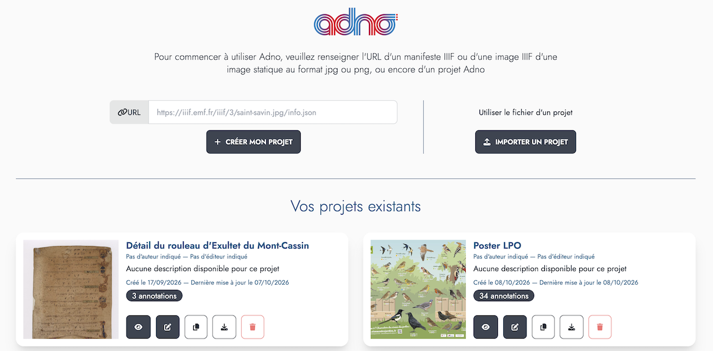
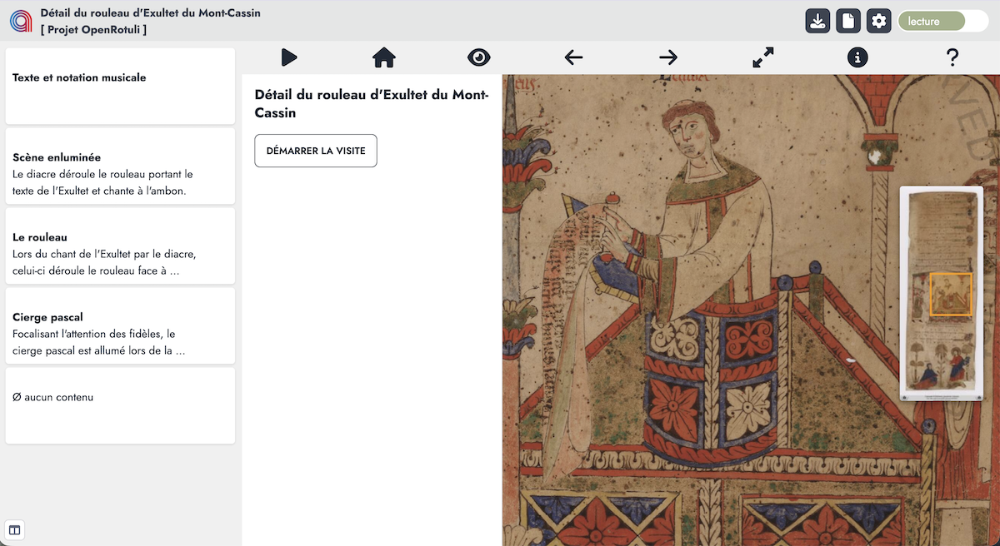
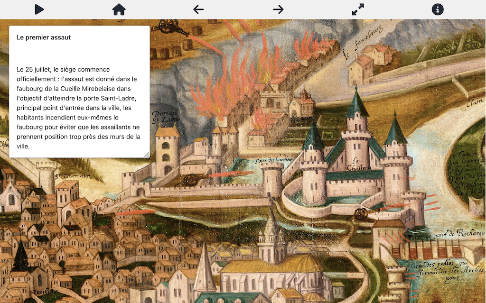
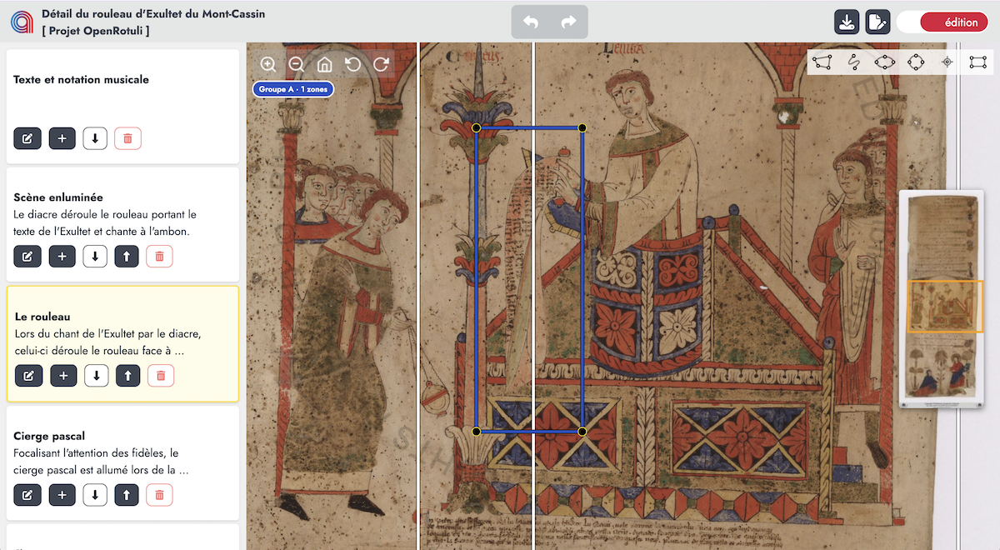
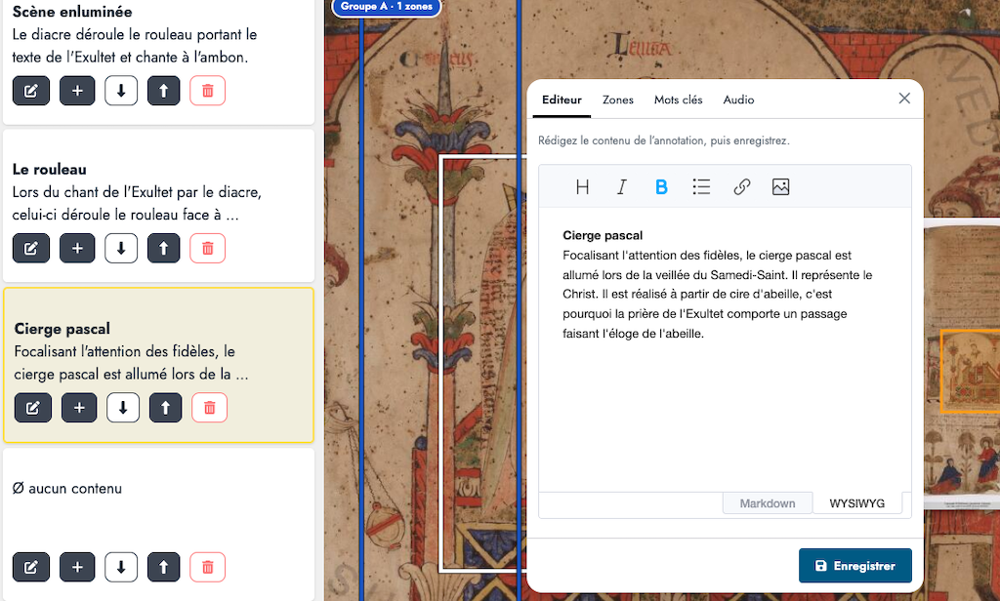
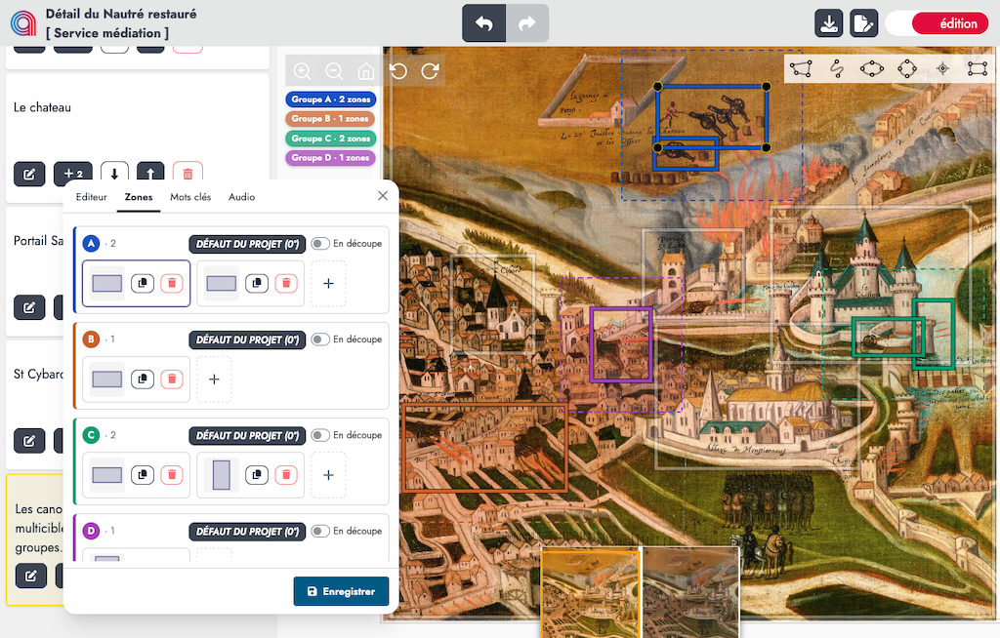
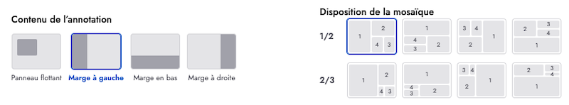

## Une application en ligne

Le plus simple pour commencer est d'utiliser [l'instance en ligne](https://w.adno.app) de Adno. Elle est gratuite et ne nécessite pas d'inscription. Vous pouvez aussi partir d'un des [exemples](/example) fournis sur ce site.

<a href="https://w.adno.app" target="_blank"><button type="button" class="btn btn-primary">Essayer maintenant !</button></a>
<a href="/example" target="_blank"><button type="button" class="btn btn-success">Exemples</button></a>

Adno est un logiciel libre, c'est-à-dire que vous pouvez l'utiliser et le redistribuer sans restriction aucune, vous pouvez le modifier et l'adapter à vos propres besoins. Vous pouvez donc l'installer pour vous-même et pour les autres. Les sources et les instructions d'installation sont accessibles sur [Github](https://github.com/adnodev/adno).


Adno est toujours en développement, ses fonctionnalités et son interface évoluent.


## Débuter un projet 

L'écran d'accueil se présente comme le tableau de bord de Adno pour créer, importer et gérer les projets dans le navigateur. 



Ce tableau de bord de Adno dans votre navigateur permet :

- **de créer un projet** en saisissant dans le formulaire l'adresse sur le web d'une image statique, d'une image ou d'un manifeste IIIF ou encore celle d'un projet Adno,
- **d'importer un projet** en chargeant le fichier d'un projet Adno, 
- **de récupérer un projet** préexistant,
- **de gérer vos projets** précédemment créés et mémorisés dans votre navigateur. 


Pour chaque projet existant dans le navigateur, une série de boutons permet d'accéder aux fonctionnalités suivantes :

- **<i class="fa-solid fa-eye"></i> Prévisualiser** 
- **<i class="fa-solid fa-pen-to-square"></i> Éditer** 
- **<i class="fa-solid fa-copy"></i> Dupliquer** 
- **<i class="fa-solid fa-download"></i> Télécharger** 
- **<i class="fa-solid fa-trash"></i> Supprimer**  

### Partir d'une image statique

L'image au format `png` ou `jpg` doit être présente en permanence en ligne et vous devez connaître son adresse (l'URL). Entrez cette URL dans le champ dédié puis cliquez sur `Créer mon projet`.

````
https://upload.wikimedia.org/wikipedia/commons/f/f3/Chenille_de_Grand_porte_queue_%28macaon%29.jpg
````

### Partir d'une ressource IIIF

Si vous ne connaissez pas IIIF, consultez cette [page de présentation](https://doc.biblissima.fr/iiif/introduction-iiif/) issue de la [formation à IIIF créée par Régis Robineau](https://doc.biblissima.fr/formation-iiif/) dans le cadre de Biblissima+.

Vous pouvez utiliser un manifeste IIIF ou une image IIIF. 

#### Un manifeste IIIF

 

Il s’agit d’une URL fournie par le diffuseur. Ce lien est souvent associé au logo IIIF ci-contre.

Le manifeste décrit le document avec ses métadonnées et les références des images qu'il contient.

```
https://api.artic.edu/api/v1/artworks/251131/manifest.json
```

Si il y a plusieurs images, sélectionnez en une.


Vous avez aussi la possibilité de récupérer l'URL `info.json` de chaque image présente dans le manifeste en utilisant ce [formulaire](/fr/blog/comment-extraire-les-images-dun-manifeste).

#### Une image IIIF

Vous utilisez alors l'url directe d'une image IIIF, elle se termine toujours par `info.json`

```
https://gallica.bnf.fr/iiif/ark:/12148/btv1b8626777x/f13/info.json
```

### Partir d'un exemple

La [page des exemples](/fr/example/) propose, pour commencer, des ressources issues des domaines les plus divers. 

### Importer un projet 

Utilisez le bouton `Importer un projet` pour téléverser un fichier Adno préalablement téléchargé.

## Visualiser et éditer son projet 

La même interface vous permet alternativement et simplement de visualiser et d'éditer un projet en cliquant sur le sélecteur coloré **lecture** ou **édition** situé en haut à droite de l'interface. 

### Interface de visualisation

  
Dans la barre de navigation, on trouve, à gauche, le logo Adno pour retourner au tableau de bord puis les informations sur le projet, et à droite le commutateur permettant de passer du mode lecture au mode édition, ainsi que trois boutons :

- **<i class="fa-solid fa-download"></i>** pour enregistrer le projet,
- **<i class="fa-solid fa-file"></i>** pour consulter les informations du projet,
- **<i class="fa-solid fa-gear"></i>** pour régler les  paramètres de lecture :  
  - Visualisation
    - afficher le navigateur d'ensemble, 
    - afficher les contours,
    - afficher seulement les contours de l'annotation courante,
    - afficher la liste des annotations latéralement,
    - définir l'orientation de lecture par défaut,
    - activer la rotation de l'image,
    - définir les modalités de transition d'orientation,
    - afficher la barre d'outils,
    - afficher la barre d'outils en mode plein écran,
    - afficher une icône à l'intérieur des formes,
    - définir l'agencement de l'affichage des annotations multicibles.
  - Navigation
    - filtrer des annotations par mots-clés,
    - délai de passage entre deux annotations (5 secondes par défaut),
    - commencer la lecture automatique à la première annotation,
    - démarrer la lecture automatiquement au chargement,
    - définir un mode pour le rendu des audio. 
  - Annotation
    - épaisseur des annotations,
    - couleurs des contours des annotations,
    - couleur du contour de l'annotation courante,
    - couleurs des groupes d'annotations.

La liste escamotable des annotations se trouve à gauche de l'écran. Par défaut, la zone d'affichage du contenu de l'annotation courante se trouve à gauche de l'image, elle peut aussi être positionnée en bas ou à droite, ou encore flottante, en fonction du paramétrage. 

Les icônes au dessus de l'image déclenchent des actions (aussi accessibles au clavier) :  

- <i class="fa-solid fa-play"></i> / <i class="fa-solid fa-pause"></i> **Lecture automatique** / **Pause** — touches `P` ou `p`   
- <i class="fa-solid fa-magnifying-glass-minus"></i> **Retour** au début de la lecture des annotations, 
- <i class="fa-solid fa-eye"></i> / <i class="fa-solid fa-eye-slash"></i> **Afficher** / **Masquer** les contours des annotations — touches `S` ou `s`
- <i class="fa-solid fa-arrow-left"></i> **Annotation précédente** — touche `←`
- <i class="fa-solid fa-arrow-right"></i> **Annotation suivante** — touche `→`
- <i class="fa-solid fa-expand"></i> **Plein écran** ,
- <i class="fa-solid fa-circle-info"></i> **Informations** sur le projet,
- <i class="fa-solid fa-question"></i> **Aide**, raccourcis clavier .

#### Liste des annotations

Un clic sur la carte d'une annotation permet de la sélectionner comme annotation courante et de positionner l'image sur la zone associée à cette annotation, ou sur la zone englobant les différentes zones associées à cette annotation dans le cas d'une annotation multicible.

Une icône en bas à droite de l'écran permet de gérer l'affichage de la liste des annotations : 
- déployée,
- repliée, dans ce cas les numéros des annotations s'affichent, 
- déployée au survol, affichage dynamique de la liste, sinon repliée.


#### Vue plein écran

En vue plein écran seule l'annotation courante est visible. L'affichage ou non des icônes est paramétrable. 



#### Raccourcis clavier

Des raccourcis clavier facilitent l'accessibilité :

- `p` ou `P` : lance la lecture automatique, 
- `e` ou `E` : bascule en plein écran ou retour,
- `s` ou `S` : montre ou pas les délimitations des annotations,
- `t` ou `T` : montre ou pas les boutons,
- <code><i class="fa-solid fa-arrow-left"></i></code> et <code><i class="fa-solid fa-arrow-right"></i></code> passer de l'annotation courante à la précédente ou à la suivante.  

### Interface d'édition



Dans la barre de navigation, on trouve, à gauche, le logo Adno pour retourner au tableau de bord et les informations sur le projet, au centre les boutons pour annuler ou rétablir les dernières actions, et à droite un sélecteur permettant de passer du mode édition au mode lecture, ainsi qu'un bouton pour enregistrer le projet et un autre pour éditer les informations du projet.

- <i class="fa-solid fa-reply "></i> **annuler** la dernière action,
- <i class="fa-solid fa-share"></i> **rétablir** l'action annulée,
- <i class="fa-solid fa-download"></i> **enregistrer** le projet,
- <i class="fa-solid fa-file"></i> **éditer** les informations du projet.

Pour créer une nouvelle annotation choisissez une forme d'annotation :
 

Puis sélectionnez une zone sur l'image en effectuant un cliquer-glisser. Dès que vous relâchez, une annotation vide est ajoutée à la liste des annotations. Cliquez ensuite sur le bouton d'édition pour ajouter un contenu.

Pour modifier le contenu d'une annotation existante, cliquez sur sa carte puis sur le bouton d'édition. Pour la redimensionner, agissez sur les petit ronds placés sur le contour (formes régulières).

Actions pour gérer chaque annotation depuis la liste des annotations :

- <i class="fa-solid fa-pen-to-square"></i> **Éditer** cette annotation, 
- <i class="fa-solid fa-plus"></i> **Ajouter** une nouvelle cible à l'annotation,
- **<i class="fa-solid fa-up-long"></i> <i class="fa-solid fa-down-long"></i> Déplacer** l'annotation dans la liste des annotations,
- **<i class="fa-solid fa-trash"></i> Supprimer** l'annotation. 

#### Éditer une annotation



Cette fenêtre modale propose quatre onglets : 
- **Éditeur** édition du contenu de l'annotation,
- **Zones** gestion des zones cibles sur l'image,
- **Mots-clés** pour associer des mots-clés à l'annotation,
- **Audio** pour associer une ressource audio à l'annotation.

##### Interface d'édition (par défaut)

Le contenu d'une annotation est généralement un court texte. Il est cependant possible d'insérer du contenu enrichi. 

Deux modes d'éditions sont disponibles : 

- [WYSIWYG](https://fr.wikipedia.org/wiki/What_you_see_is_what_you_get) avec des icônes (niveaux de titres, italique, gras, liste à puces, lien hypertexte, image),
- [Markdown](https://fr.wikipedia.org/wiki/Markdown) un système léger de balisage du texte, c'est de cette façon que le contenu des annotations est représenté.   

##### Gestion des zones 

Une des originalités de Adno est de pouvoir gérer des annotations multicibles, c'est-à-dire des annotations qui pointent vers différentes zones sur l'image. Les cibles peuvent être réparties dans différents groupes afin de les afficher séparément. L'agencement de l'affichage est guidé automatiquement par cette répartition en groupes.

**En mode édition** 



**En mode lecture** Le contenu de chaque annotation s'affiche en marge de l'image (à gauche, à droite ou en bas) ou dans une fenêtre flottante. Différents cas se présentent pour la visualisation des annotations : 
- une annotation avec une seule cible ou plusieurs cibles rassemblées dans un seul groupe : le focus est mis sur le quadrilatère qui rassemble toutes les cibles, 
- une annotation avec plusieurs groupes : il y a autant de zone d'affichage que de groupes, ces zones se répartissent en spirale, dans un rapport de 1/2 ou de 2/3, verticalement ou horizontalement.


**Réglages** des modalités d'affichage du contenu de l'annotation et de la répartition des groupes de cibles. 



##### Gestion des mots-clés 

Cet onglet permet d'associer un ou plusieurs mots-clés à chaque annotation. Il est possible de sélectionner un mot-clé existant ou d'en créer un nouveau. Ne pas oublier d'appuyer sur la touche `Entrée` après avoir saisi chaque mot clé.   

Dans les paramètres de lecture, il devient alors possible de visualiser des parcours par mots-clés. 

##### Association d'un audio

Cet onglet permet d'associer une ressource audio à l'annotation, le premier champ reçoit l'URL du fichier audio et le second des informations sur cette ressources (crédit ou autre).

Dans les paramètres de lecture, préciser la façon dont les audios sont joués, individuellement ou en son spatialisé.

## Retrouver ses projets 

Les projets sont conservés dans votre navigateur. Vous pourrez les retrouver en rouvrant une session sur le site à partir duquel ils ont été créés. 


**Pensez à télécharger régulièrement vos projets**

En navigation privée les projets sont "oubliés" à la fermeture de la session. Il peut en être de même avec un paramétrage restrictif de votre navigateur. 


## Partager ses projets

Présent à différents endroits dans l'interface d'Adno, le bouton **<i class="fas fa-download"></i>** offre cette fenêtre modale qui présente comment sauvegarder et partager un projet, en l'exportant sous la forme d'un fichier Adno ou d'un manifeste IIIF. 

Dans un cas comme dans l'autre,  ce fichier se présente sous la forme d'un simple fichier textuel au [format json](https://json.org/json-fr.html). En règle générale, il reste très léger. Vous pouvez donc facilement le transmettre par mail. Après l'avoir importé dans Adno, votre correspondant pourra le visualiser mais aussi proposer des variantes ou des corrections à votre projet. 

Vous pouvez aussi déposer votre fichier en ligne et diffuser son URL. Pour ce faire, il est possible d'utiliser un site web ou un serveur de fichiers. Le protocole IPFS offre une alternative décentralisée intéressante. 

Consultez les pages [Google Drive](/fr/docs/references/gdrive/), [Dropbox](/fr/docs/references/dropbox/) ou [IPFS](/fr/docs/references/ipfs/) du guide de référence de la documentation pour découvrir comment procéder avec ces services pour déposer des images, des manifestes IIIF ou des projets Adno.

### Insérer un projet dans une page web

Dès lors que votre projet Adno est en ligne, il est possible de le rendre visible dans une page web en insérant une balise `iframe` en ajustant les paramètres ci-après. 

```
<iframe 
    src="https://w.adno.app/#/embed?url=URL_DU_PROJET" 
    title="Titre du projet"
    height="600px" 
    width="100%"
    allow="fullscreen"
></iframe>

```


Pour plus de sûreté, il est conseillé d'encoder l'URL passée en paramètre. Adno fournit un utilitaire pour ce faire tout en ajustant les paramètres. Il suffit d'ajouter `/#/link` à la suite de l'URL du site. Exemple : [https://w.adno.app/#/link](https://w.adno.app/#/link). 


À noter qu'en insérant l'URL d'une image IIIF ou non, ou d'un manifeste IIIF, vous pouvez ainsi disposer d'un visualiseur IIIF facile à installer.

Le module [Page Block Adno](https://github.com/adnodev/Omeka-S-module-PageBlockAdno) permet la visualisation des projets Adno dans les pages des sites Omeka S.

Il est aussi possible d'utiliser le composant [Adno views tags](https://github.com/adnodev/adno-views-tag) pour disposer de différents types de visualisations (listes, diapos, etc.). 

## Difficultés 

Adno fonctionne dans le navigateur et s’appuie sur des ressources hébergées ailleurs sur le web. Cette approche peut être soumise à des restrictions qui peuvent impacter le fonctionnemet d'Adno et de son intégration dans des pages web. 

Les cas les plus fréquents : 

- Il n'est pas possible d'insérer une ressource désignée par une adresse débutant par `http` dans un site sécurisé accessible en `https`. Par exemple, si vous déposez une image sur le service [IIIFHosting](http://iiifhosting.com/), l'URL fournie par défaut est en `http`. Pour l'utiliser dans Adno, n'oubliez pas de changer `http` en `https` au début de l'URL.
- Des [paramétrages CORS](/fr/docs/references/cors/) sur un serveur tiers interdisent le transfert de données vers un autre domaine. L'instance officielle de Adno utilise un service tiers qui lui est dédié pour contourner ce problème.

## Traduction

Si Adno n'est pas disponible dans la langue de votre choix, vous pouvez contribuer ajoutant une nouvelle langue et en proposant des traductions sur l'espace Adno de la plate-forme [Weblate](https://hosted.weblate.org/projects/adno/). De la même façon, vous pouvez proposer des modifications et des corrections aux traductions existantes. 

## Installation

Adno est un service disponible librement et gratuitement en ligne. Adno est aussi un logiciel libre, vous pouvez donc l'installer chez vous voire l'adapter à vos besoins. Vous retrouverez le code source et toutes les infos sur la [forge logicielle de Adno](https://github.com/adnodev/adno).
 
## Aide 

Consultez la foire aux questions et la documentation pour en savoir plus (attention ! ces parties sont encore incomplètes). 
En cas de problème ou de suggestion n'hésitez pas à [nous contacter](/contact).

